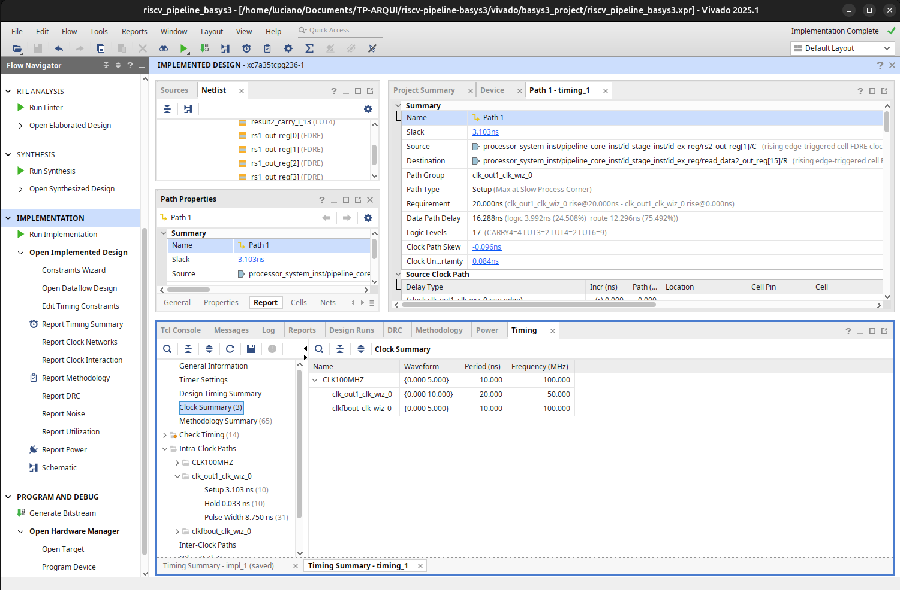
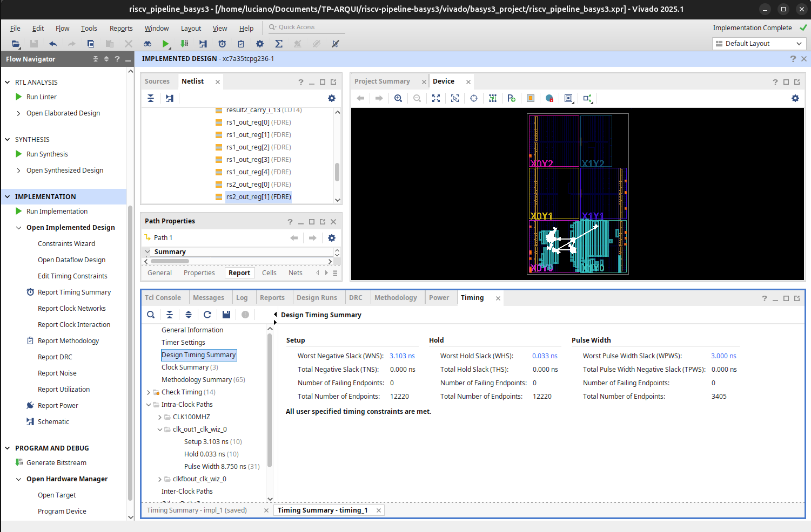
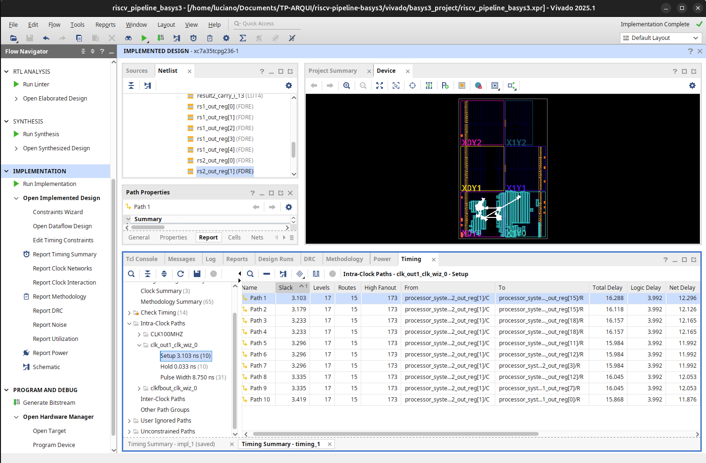
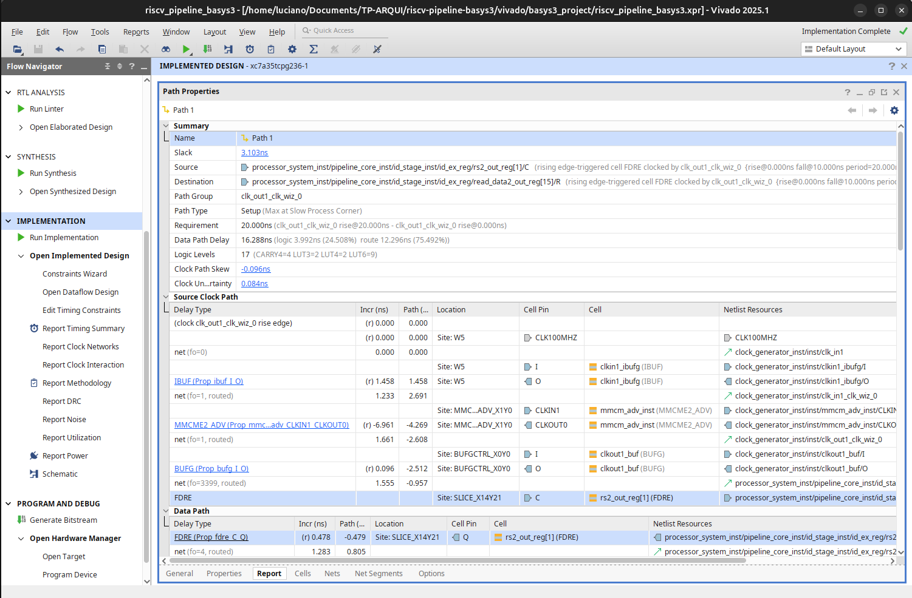
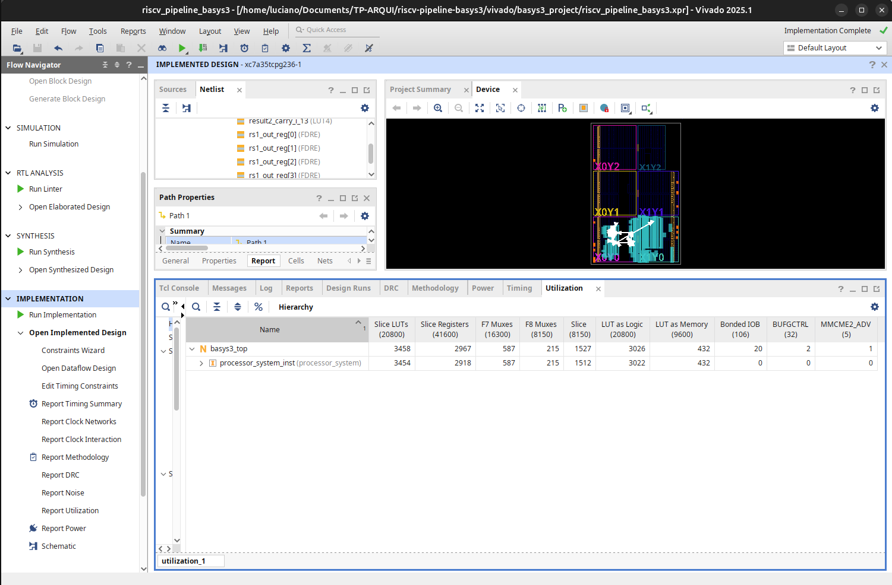

# Análisis de timing, camino crítico y frecuencia — Basys 3

**Asignatura:** Arquitectura de Computadoras
**Proyecto:** Procesador RISC-V segmentado de cinco etapas con Debug Unit UART
**Plataforma:** Digilent Basys 3 — Artix-7 XC7A35T-1CPG236C
**Herramienta:** Vivado 2025.1
**Fecha del análisis:** 19 de noviembre de 2026
**Diseño:** `basys3_top`
**Estado de implementación:** Routed — Implementación completada

---

## 1. Objetivo

El objetivo de este análisis es evaluar el comportamiento temporal del procesador RISC-V implementado en la FPGA Basys 3.

Se busca identificar los caminos temporales más restrictivos, analizar los retardos de lógica y enrutamiento, interpretar los márgenes de setup y hold, evaluar el clock skew y justificar la frecuencia seleccionada para el funcionamiento del sistema.

El análisis se realiza sobre el diseño implementado mediante Vivado 2025.1, utilizando los resultados posteriores a placement y routing.

Se conservan los reportes originales y las capturas de Vivado como evidencia reproducible.

## 2. Arquitectura de reloj

### 2.1 Reloj externo

La placa Basys 3 proporciona una señal de reloj de 100 MHz mediante su oscilador integrado.

Su período es:

\[
T=\frac{1}{f}
\]

\[
T=\frac{1}{100\ MHz}=10\ ns
\]

La señal ingresa por el pin W5 de la FPGA, identificado como `CLK100MHZ`.

### 2.2 Clocking Wizard

Durante el desarrollo se incorporó el IP Clocking Wizard para generar un reloj interno de 50 MHz a partir de la señal externa de 100 MHz.

La configuración final es:

| Señal | Frecuencia | Período |
|---|---:|---:|
| `CLK100MHZ` | 100 MHz | 10 ns |
| `clk_out1_clk_wiz_0` | 50 MHz | 20 ns |
| `clkfbout_clk_wiz_0` | 100 MHz | 10 ns |

El reloj `clkfbout_clk_wiz_0` corresponde a la realimentación interna del MMCM.

El procesador, la Debug Unit, el cargador y la interfaz UART utilizan el reloj interno de 50 MHz.

La utilización del Clocking Wizard permite generar el reloj mediante recursos especializados de la FPGA.

Los modos RUN y STEP no se implementan interrumpiendo físicamente el reloj, sino mediante señales de habilitación internas.

**Evidencia:**

## 3. Análisis inicial a 100 MHz

La implementación inicial utilizaba un reloj de 100 MHz, correspondiente a un período de 10 ns.

Durante el análisis de timing se detectaron violaciones de setup.

Los resultados registrados fueron:

| Parámetro | Resultado |
|---|---:|
| Frecuencia | 100 MHz |
| Período | 10 ns |
| WNS | -3.558 ns |
| TNS | -1036.007 ns |
| Endpoints con violaciones de setup | 601 |
| Requirement del peor camino | 10.000 ns |
| Data Path Delay | 13.519 ns |
| Logic Levels | 25 |

El WNS negativo indicaba que el peor recorrido incumplía su restricción temporal por 3.558 ns.

El TNS negativo indicaba la existencia de múltiples violaciones de setup.

El camino problemático identificado durante esta implementación estaba relacionado con lógica de EX/MEM y la actualización del contador de programa.

En consecuencia, no se podía considerar que el diseño cumpliera las restricciones temporales a 100 MHz.

### 3.1 Decisión de diseño

Para resolver el problema se seleccionó un reloj interno de 50 MHz, generado mediante Clocking Wizard.

Esto incrementó el período disponible de 10 ns a 20 ns.

La modificación permitió obtener una implementación sin violaciones de setup ni hold en los caminos analizados por Vivado.

Esta decisión se tomó priorizando el cumplimiento de timing y la estabilidad de la implementación sobre una frecuencia de funcionamiento más elevada.

## 4. Resultados finales de timing a 50 MHz

Se ejecutó el análisis temporal sobre el diseño implementado y enrutado.

Los resultados obtenidos fueron:

| Parámetro | Resultado |
|---|---:|
| Frecuencia interna | 50 MHz |
| Período | 20 ns |
| WNS | +3.103 ns |
| TNS | 0.000 ns |
| WHS | +0.033 ns |
| THS | 0.000 ns |
| WPWS | +3.000 ns |
| TPWS | 0.000 ns |
| Endpoints con violaciones de setup | 0 |
| Endpoints con violaciones de hold | 0 |

Vivado informó:

> All user specified timing constraints are met.

Esto confirma que el diseño cumple los chequeos temporales especificados para los caminos analizados.

El WNS positivo indica que el peor recorrido de setup dispone de un margen de 3.103 ns.

El TNS igual a cero indica que no existen violaciones de setup entre los endpoints analizados.

El WHS positivo y el THS igual a cero indican que los recorridos evaluados también cumplen los requisitos de hold.

**Evidencia:**

## 5. Identificación del camino crítico de setup

El análisis de los caminos de setup permitió identificar el recorrido con menor margen temporal de la implementación final.

Los resultados corresponden al reporte `critical_paths_setup.txt`.

### 5.1 Identificación del recorrido

**Registro de origen:**

`processor_system_inst/pipeline_core_inst/id_stage_inst/id_ex_reg/rs2_out_reg[1]`

Pin de lanzamiento: `C`.

**Registro de destino:**

`processor_system_inst/pipeline_core_inst/id_stage_inst/id_ex_reg/read_data2_out_reg[15]`

Pin de destino: `R`.

**Grupo de reloj:**

`clk_out1_clk_wiz_0`

**Tipo de análisis:**

Setup — Max at Slow Process Corner.

Es importante destacar que el endpoint corresponde al pin de reset `R` de un flip-flop FDRE, no a su entrada convencional de datos `D`.

Por lo tanto, el recorrido debe interpretarse considerando su naturaleza de camino hacia una señal de control/reset.

### 5.2 Métricas del recorrido

| Parámetro | Valor |
|---|---:|
| Requirement | 20.000 ns |
| Slack | +3.103 ns |
| Data Path Delay | 16.288 ns |
| Logic Delay | 3.992 ns |
| Routing Delay | 12.296 ns |
| Logic Levels | 17 |
| Clock Path Skew | -0.096 ns |
| Clock Uncertainty | 0.084 ns |

El recorrido atraviesa diferentes recursos de lógica combinacional de la FPGA.

Según el reporte:

- 9 LUT6.
- 2 LUT4.
- 2 LUT3.
- 4 CARRY4.

En total, se identificaron 17 niveles lógicos.

La ruta incluye lógica sintetizada asociada al forwarding, la ALU y señales de control del procesador.

### 5.3 Análisis del retardo

El retardo total del camino de datos es:

\[
T_{data}=16.288\ ns
\]

Se compone de:

\[
T_{logic}=3.992\ ns
\]

\[
T_{route}=12.296\ ns
\]

En términos porcentuales:

| Componente | Porcentaje |
|---|---:|
| Lógica | 24.508 % |
| Enrutamiento | 75.492 % |

El principal componente del retardo corresponde al enrutamiento físico.

Esto demuestra que el comportamiento temporal del procesador no depende exclusivamente de la cantidad de operaciones lógicas, sino también de la ubicación de los recursos y de las conexiones entre ellos.

El análisis temporal debe realizarse después de la implementación física para considerar los retardos reales estimados por Vivado.

**Evidencia:**

## 6. Análisis del clock skew

El clock skew representa la diferencia de llegada de la señal de reloj entre los puntos de lanzamiento y captura de un recorrido.

Esta diferencia puede modificar el margen temporal disponible y afectar los chequeos de setup y hold.

Para el peor camino de setup, Vivado informó:

| Parámetro | Valor |
|---|---:|
| Source Clock Delay (SCD) | -0.957 ns |
| Destination Clock Delay (DCD) | -1.544 ns |
| Clock Pessimism Removal (CPR) | +0.492 ns |
| Clock Path Skew | -0.096 ns |
| Clock Uncertainty | 0.084 ns |

Vivado calcula el skew efectivo de este recorrido considerando:

\[
Skew=DCD-SCD+CPR
\]

Sustituyendo los valores:

\[
Skew=-1.544-(-0.957)+0.492
\]

\[
Skew\approx-0.096\ ns
\]

Las pequeñas diferencias debidas al redondeo corresponden a la precisión con la que Vivado presenta los valores.

El skew efectivo negativo reduce ligeramente el margen disponible para setup.

Sin embargo, el recorrido presenta un slack de +3.103 ns, por lo que cumple su requisito temporal.

El valor de skew no representa una violación por sí mismo. Su importancia radica en cómo afecta los márgenes de temporización.

**Evidencia:**

## 7. Análisis de hold

Además de setup, se analizaron los requisitos de hold.

El hold time establece el intervalo mínimo durante el cual un dato debe permanecer estable después del flanco de captura.

Para la implementación final se obtuvo:

| Parámetro | Valor |
|---|---:|
| WHS | +0.033 ns |
| THS | 0.000 ns |
| Endpoints con violaciones | 0 |

### 7.1 Peor camino de hold

El recorrido más restrictivo de hold identificado por Vivado comienza en:

`processor_system_inst/pipeline_core_inst/ex_stage_inst/ex_mem_reg/store_data_out_reg[21]`

Y termina en:

`processor_system_inst/debug_unit_inst/snapshot_ex_mem_store_data_reg[21]`

Se trata de un recorrido entre un registro del pipeline EX/MEM y un registro utilizado por la Debug Unit para capturar información del procesador.

Los resultados son:

| Parámetro | Valor |
|---|---:|
| Slack | +0.033 ns |
| Requirement | 0.000 ns |
| Data Path Delay | 0.367 ns |
| Logic Delay | 0.141 ns |
| Routing Delay | 0.226 ns |
| Logic Levels | 0 |
| Clock Path Skew | +0.264 ns |

El recorrido presenta un retardo reducido, ya que conecta registros sin atravesar niveles adicionales de lógica combinacional.

El slack de hold es positivo, aunque pequeño.

Por lo tanto, el recorrido cumple el requisito de hold bajo las condiciones analizadas.

El análisis se realizó en el Fast Process Corner, correspondiente al escenario considerado para evaluar los retardos mínimos.

Los valores detallados se conservan en `critical_paths_hold.txt`.

## 8. Interacción entre clocks

Se ejecutó el comando `report_clock_interaction` para analizar las relaciones temporales entre los relojes del diseño.

El reporte identifica un grupo de caminos secuenciales entre registros que utilizan:

`clk_out1_clk_wiz_0`

Los resultados fueron:

| Parámetro | Valor |
|---|---:|
| Clock de origen | `clk_out1_clk_wiz_0` |
| Clock de destino | `clk_out1_clk_wiz_0` |
| Requirement | 20.000 ns |
| WNS | +3.10 ns |
| TNS | 0.00 ns |
| Endpoints con violaciones | 0 |
| Endpoints analizados | 12220 |
| Clasificación | Clean |
| Inter-Clock Constraints | Timed |

El reporte no identifica transferencias problemáticas entre dominios de reloj distintos.

El dominio principal del sistema utiliza el reloj generado de 50 MHz.

El reporte completo se conserva en `clock_interaction.txt`.

## 9. Verificación de restricciones temporales

Se ejecutó el comando:

`check_timing -verbose`

El objetivo fue identificar posibles problemas en las restricciones temporales del diseño.

### 9.1 Resultados satisfactorios

Vivado informó:

| Comprobación | Resultado |
|---|---:|
| Registros sin clock | 0 |
| Registros con clock constante | 0 |
| Endpoints internos sin restricción de máximo retardo | 0 |
| Registros con múltiples clocks | 0 |
| Clocks generados desconectados | 0 |
| Lazos combinacionales | 0 |
| Lazos combinacionales con latches | 0 |

Estos resultados indican que el análisis no detectó problemas en esas categorías.

### 9.2 Entradas con false path

El reporte identifica dos entradas sin `input delay`, cubiertas mediante restricciones `false path`:

- `RsRx`.
- `btnC`.

Estas entradas corresponden a la recepción UART y al botón físico de reset.

Se trata de señales provenientes del exterior del dominio síncrono principal.

Las restricciones utilizadas deben interpretarse teniendo en cuenta el diseño de sincronización y control de estas interfaces.

El reporte de timing no sustituye la verificación funcional de esos mecanismos.

### 9.3 Salidas sin output delay

Vivado identificó 12 puertos sin restricciones explícitas de `output delay`:

- `RsTx`.
- `led[0]` a `led[9]`.
- `led[15]`.

Esta situación debe documentarse porque significa que no se está verificando una restricción temporal externa completa de esas salidas.

Los LEDs se utilizan como señales visuales de diagnóstico y no requieren una sincronización de alta velocidad con otro dispositivo.

En el caso de `RsTx`, la comunicación UART fue verificada funcionalmente sobre la placa física a 115200 baudios.

Sin embargo, esa prueba funcional no equivale a un análisis formal de todos los retardos de salida.

En consecuencia, el cumplimiento informado por Vivado debe interpretarse como cumplimiento de las restricciones temporales efectivamente especificadas, especialmente las correspondientes al dominio síncrono interno.

Los detalles se conservan en `check_timing.txt`.

## 10. Advertencias metodológicas

El reporte de timing también contiene advertencias de metodología registradas por Vivado.

Entre ellas aparecen:

| Regla | Descripción | Cantidad |
|---|---|---:|
| LUTAR-1 | LUT drives async reset alert | 1 |
| SYNTH-5 | Mapped onto distributed RAM because of timing constraints | 64 |

La primera advertencia está relacionada con el uso de lógica LUT en una red que controla reset asíncrono.

Esta observación resulta relevante porque el peor camino de setup identificado también termina en el pin de reset de un registro.

No debe interpretarse automáticamente como una falla funcional, pero constituye un aspecto de diseño que merece especial atención.

La segunda advertencia indica que Vivado implementó determinadas estructuras de memoria mediante recursos de RAM distribuida.

El propio reporte advierte que el resumen metodológico puede proceder de una ejecución anterior y recomienda actualizarlo para obtener el estado más reciente.

No se modificó el RTL durante este análisis. Se conservaron los resultados de la implementación físicamente validada en Basys 3.

## 11. Utilización de recursos de FPGA

El reporte `report_utilization` permite analizar los recursos empleados en la Artix-7.

Los principales resultados fueron:

| Recurso | Utilizados | Disponibles | Utilización |
|---|---:|---:|---:|
| Slice LUTs | 3458 | 20800 | 16.63 % |
| LUT as Logic | 3026 | 20800 | 14.55 % |
| LUT as Memory | 432 | 9600 | 4.50 % |
| Slice Registers | 2967 | 41600 | 7.13 % |
| F7 Muxes | 587 | 16300 | 3.60 % |
| F8 Muxes | 215 | 8150 | 2.64 % |
| Slices | 1527 | 8150 | 18.74 % |
| DSPs | 0 | 90 | 0.00 % |
| BUFGCTRL | 2 | 32 | 6.25 % |
| MMCME2_ADV | 1 | 5 | 20.00 % |

La implementación utiliza aproximadamente el 16.63 % de las LUTs y el 7.13 % de los registros disponibles.

También utiliza recursos dedicados de distribución y generación de clock.

El uso de LUTs como memoria evidencia la implementación de estructuras de almacenamiento mediante RAM distribuida.

El diseño no utiliza bloques DSP dedicados.

Los porcentajes indican que existe capacidad lógica disponible en la FPGA.

Sin embargo, disponer de recursos libres no garantiza que el procesador pueda funcionar a una frecuencia mayor, porque el límite temporal depende de los retardos de los recorridos y de las restricciones aplicadas.

**Evidencia:**

## 12. Análisis de frecuencia de funcionamiento

La frecuencia seleccionada para el procesador es:

\[
f=50\ MHz
\]

Por lo tanto:

\[
T=20\ ns
\]

El diseño presenta un WNS de setup positivo:

\[
WNS=+3.103\ ns
\]

Para un recorrido convencional de setup con captura en el ciclo siguiente, una estimación simplificada del período mínimo puede obtenerse restando el margen disponible al período establecido:

\[
T_{estimado}=20-3.103
\]

\[
T_{estimado}=16.897\ ns
\]

Su frecuencia equivalente sería:

\[
f_{estimada}\approx59.18\ MHz
\]

Esta operación se presenta únicamente como referencia conceptual.

**No constituye una determinación de la frecuencia máxima del procesador.**

En particular, el peor recorrido reportado termina en una entrada de reset, por lo que no debe utilizarse sin un análisis adicional para establecer la frecuencia máxima funcional del datapath.

Para determinar una frecuencia máxima verificable sería necesario estudiar los caminos temporales relevantes, revisar las restricciones, modificar la frecuencia objetivo y realizar nuevamente el análisis de implementación.

No se realizaron esos experimentos adicionales durante esta etapa.

En consecuencia, la frecuencia adoptada y validada para el sistema es de **50 MHz**.

## 13. Evidencias conservadas

Los reportes originales se encuentran en:

`docs/evidencias_timing/reportes/`

| Archivo | Contenido |
|---|---|
| `timing_summary.txt` | Resumen de timing |
| `critical_paths_setup.txt` | Caminos más restrictivos de setup |
| `critical_paths_hold.txt` | Caminos más restrictivos de hold |
| `clock_interaction.txt` | Interacciones entre dominios de clock |
| `check_timing.txt` | Comprobación de restricciones |
| `utilization.txt` | Utilización de recursos |

Las capturas se encuentran en:

`docs/evidencias_timing/capturas/`

| Archivo | Evidencia |
|---|---|
| `01_timing_summary.png` | Cumplimiento de setup y hold |
| `02_camino_critico.png` | Caminos más restrictivos de setup |
| `03_clock_skew.png` | Detalle del peor camino y clock skew |
| `04_clock_summary.png` | Clocks reconocidos por Vivado |
| `05_utilization.png` | Utilización de recursos de FPGA |

La evidencia funcional sobre la placa Basys 3 se encuentra documentada en:

`docs/basys3_integration.md`

Y sus capturas y registros se conservan en:

`docs/evidencias_basys3/`

## 14. Conclusiones

El análisis temporal del procesador RISC-V permitió justificar la selección de un reloj interno de 50 MHz.

La implementación inicial a 100 MHz presentaba violaciones de setup, con un WNS de -3.558 ns y un TNS de -1036.007 ns.

La incorporación del Clocking Wizard permitió generar un reloj interno de 50 MHz y obtener una implementación sin violaciones de setup ni hold entre los caminos analizados.

Los resultados finales fueron:

- WNS: +3.103 ns.
- TNS: 0.000 ns.
- WHS: +0.033 ns.
- THS: 0.000 ns.

Se identificó el peor camino de setup, con un retardo de datos de 16.288 ns y un skew efectivo de -0.096 ns.

El análisis permitió comprobar que el enrutamiento físico representa aproximadamente el 75.5 % del retardo total de ese recorrido.

También se identificó el peor camino de hold entre el registro EX/MEM del procesador y un registro de snapshot de la Debug Unit.

Se verificaron las interacciones de clock y se documentaron las restricciones de las interfaces externas que no cuentan con análisis completo de input/output delay.

Finalmente, se comprobó que la FPGA dispone de capacidad lógica suficiente para alojar el sistema y que la principal dificultad encontrada durante la implementación inicial estaba relacionada con el cumplimiento temporal.

La frecuencia de 50 MHz fue utilizada en la implementación final y en las pruebas físicas realizadas sobre la placa Basys 3.

**Conclusión general:** el procesador RISC-V implementado cumple las restricciones temporales internas analizadas por Vivado a 50 MHz, con resultados positivos de setup y hold y validación funcional satisfactoria sobre hardware real.

---

**Estado del paso 25:** análisis de timing, camino crítico, skew y frecuencia documentado.

**Siguiente etapa:** paso 26 — cierre general, validación de requisitos, documentación e informe final del trabajo práctico.
